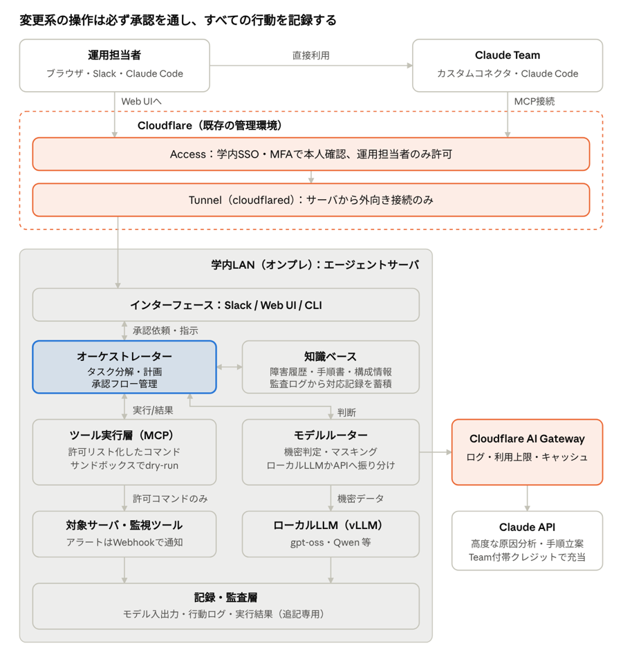

# サーバ運用AIエージェント導入検討資料

## この資料について

研究室で管理するサーバの運用（監視・障害一次対応・定型保守）をAIエージェントに任せるため、学内にエージェント用サーバを1台立てる。エージェントは「調べる・提案する」から始め、実際の変更は人間の承認を経て実行する。ログや構成情報など外に出せないデータはローカルモデルで扱い、高度な原因分析だけClaude APIに回す。API代はClaude Team（研究者向けプラン）の付帯クレジットでまかなう。

**目的は2つ**

1. **サーバ運用エージェントを動かす**：運用の手間を減らし、障害対応を速く確実にする
2. **技術を研究室として身につける**：Cloudflare（入口・認証）、LLMの推論基盤、LLMの学習を、作りながら学ぶ

2つ目の目的のため、APIだけで済む部分でもローカル推論基盤を自前で構築し、スパコンを使ったローカルモデルの学習にも取り組む。学習は「運用に必須ではないが、勝てる所を狙えば実益も出る」という位置づけで、狭い仕事に特化した小型モデルを作り、評価で既存モデルに勝ったものだけを本番のルーターに組み込む（詳しくは「ローカルモデルの学習」）。担当と進め方は[推進計画・役割分担](./task_summary.md)を参照。

| 学びのトラック | 学ぶ技術 | エージェントへの貢献 |
| --- | --- | --- |
| ネットワーク・入口 | Cloudflare Tunnel・Access・AI Gateway、ゼロトラスト、SSO連携 | 安全な入口、APIの利用ログと上限 |
| 推論基盤 | vLLMでの提供、量子化、GPUメモリの見積もり、負荷試験、監視 | ローカルLLMの本番サーバ |
| 学習 | 評価設計、LoRA・SFT・DPO、継続事前学習、スパコンでの分散学習 | マスキング・ログ分類など、ルーターに入る特化モデル |

**使い方と更新ルール**

- 各セクションは「現時点の案」。調べて分かったこと・試して分かったことは、該当セクションを直接書き換える
- 書き換えたら、末尾の「改善ログ」に1行追記する（日付・誰が・何を・なぜ）
- 未確定の点は「未決事項・要調査リスト」にチェックボックスで残し、解決したらチェックして結論を本文に反映する
- 料金・規約・モデル名は変わりやすい。数字を使うときは出典リンクと確認日を必ず添える

## 全体構成

## 全体構成

外部からサーバへの入口は、すでに管理しているCloudflareに集約する。サーバはCloudflare Tunnelで外向きに接続するだけなので、学内ファイアウォールに受信ポートを開けずに済む。運用担当者のWeb UIも、Claude Teamのカスタムコネクタから使うMCPサーバも、Cloudflare Accessで本人確認してから通す。サーバ内ではオーケストレーターが計画と承認を管理し、モデルルーターが機密度と難易度でローカルLLMかClaude APIかを振り分け、APIへの通信はAI Gatewayを経由させてログと利用上限を管理する。

| Cloudflareの機能 | この構成での役割 | 料金・注意 |
| --- | --- | --- |
| [Tunnel](https://developers.cloudflare.com/cloudflare-one/) | Web UIとMCPサーバをHTTPSで公開。サーバ側から外向き接続のみ | 無料。サーバに`cloudflared`を常駐 |
| [Access](https://developers.cloudflare.com/cloudflare-one/access-controls/ai-controls/secure-mcp-servers/) | 学内SSO・MFAで本人確認し、研究室メンバーだけ許可。MCPサーバのOAuth認証にも対応 | Zero Trust無料枠は50ユーザーまで（[参考](https://blog.cloudflare.com/teams-plans)、要確認） |
| [AI Gateway](https://developers.cloudflare.com/ai-gateway/index.md) | Claude APIへの通信のログ・利用上限・キャッシュ・再試行 | 全プランで利用可。API代自体はAnthropicに支払う |

サーバ内は次の7層に分ける。オーケストレーターを中心に「モデルが判断 → ツールを実行 → 結果を返す」を繰り返し、危険な操作の前だけ人間に承認を求める。学習した特化モデルは、主にモデルルーターの部品として入る。

| 層 | 役割 | 実装（案） |
| --- | --- | --- |
| インターフェース | 指示・通知・承認の窓口 | Slack / Web UI / CLI（Cloudflare Access経由） |
| オーケストレーター | タスク分解・計画・承認フロー管理 | Claude Agent SDK（フックで承認を挟む） |
| モデルルーター | 機密判定・マスキング後にローカルLLMかAPIへ振り分け | LiteLLM等のゲートウェイ＋判定ルール＋学習した特化モデル（秘密情報検出・ログ分類） |
| ツール実行層 | 許可リスト化されたコマンド・スクリプトだけを実行 | MCPサーバ（読み取り系／変更系を分離） |
| サンドボックス | dry-run、権限分離、検証環境での事前実行 | コンテナ、権限を絞った専用アカウント |
| 記録・監査層 | モデル入出力・行動ログ・実行結果をすべて記録 | 追記専用ログ＋AI Gatewayのログ。匿名化して学習・評価データにも使う |
| 知識ベース | 過去の障害・手順書・サーバー構成情報。対応記録を自動で蓄積 | ベクトルDB＋Markdownの手順書 |

**本番の外側：学習・評価基盤**

学習と評価は本番の運用サーバとは切り離して行う。本番に影響を与えずに試行錯誤できるようにするためである。

| 場所 | 用途 | 備考 |
| --- | --- | --- |
| 手元・研究室のGPU | 評価ハーネスの実行、小型モデルのLoRA | 学習の流れを一周する練習台 |
| 研究室のGPUサーバ（本番と兼用） | 夜間など空き時間のSFT・DPO、学習済みモデルの影運用（本番と並べて比較） | 本番の推論を妨げない範囲で |
| スパコン | 大型モデルの評価、SFT・DPO、継続事前学習 | ジョブの順番待ちがあるため本番の推論には使わない。利用規程を要確認 |

## エージェントの実装方法

エージェント本体はClaude Agent SDK（Python）で書き、ツールはMCPサーバとして切り出す案を第一候補とする。SDKはClaude Codeと同じエージェントループ（ツール実行・文脈管理・権限制御・サブエージェント）をライブラリとして使える（[Agent SDK overview](https://code.claude.com/docs/en/agent-sdk.md)）。

**注意点**：SDKで作ったサーバ側エージェントは、Claude.aiの席（Team席）の利用枠では動かせず、APIキーで動かす必要がある（[SDK docs](https://docs.claude.com/en/docs/claude-code/sdk/sdk-overview)）。このAPI代は、Teamプランの月次APIクレジットでまかなえる（後述）。また、オーケストレーターの判断は常にAPIで行われるため、ローカルだけで完結させたい処理（マスキング、機密ログの要約）は、SDKを通さずにローカルモデルを直接呼ぶ別の処理として作る。

| 選択肢 | 向いている用途 | ローカルモデル対応 | 備考 |
| --- | --- | --- | --- |
| Claude Agent SDK | Claudeを主に使うエージェント | 公式はAnthropic API / Bedrock / Vertex。ローカルは互換ゲートウェイ経由で要検証 | `pip install claude-agent-sdk`（Python 3.10+） |
| Anthropic Client SDK（Messages API） | ループを自前で細かく制御したい場合 | 同上 | 自由度が高い分、実装量が増える |
| モデル非依存フレームワーク（LangGraph等） | ローカルとAPIを同じ枠組みで扱いたい場合 | OpenAI互換API経由で可 | 要調査：候補の比較 |

**実装ステップ（案）**

1. 評価ハーネス：評価用の障害ケースをモデルに流し、採点表を自動で出すスクリプトを最初に作る。モデル選定・プロンプト改善・学習の良し悪しを、すべてこれで測る
2. 最小エージェント：読み取り専用ツール1つ（例：指定サーバのログ取得・要約）だけを持つエージェントをSDKで動かす
3. ツールのMCP化：ログ取得、メトリクス参照、サービス状態確認、再起動などをMCPサーバとして独立させ、読み取り系と変更系を別サーバに分ける
4. 許可リストとサンドボックス：実行できるコマンドを許可リストで限定し、変更系はdry-run→承認→本番実行の順にする
5. ルーター追加：ログや構成情報の機密度でローカルモデル／Claude APIを切り替え、API送信前にIP・ホスト名・認証情報をマスクする。最初はルールと既存モデルで作り、学習した特化モデルは評価で勝ってから差し替える
6. 承認と監査：Agent SDKのフックで変更系ツールの前に人間の承認を挟み、モデル入出力と全ツール呼び出しを監査ログに残す
7. 利用者UIと公開：Web UIまたはSlack連携をCloudflare Tunnel＋Accessで公開する。MCPサーバも同じ経路で公開し、Claude Teamのカスタムコネクタから使えるようにする
8. 評価の定点観測：評価ハーネスを定期的に流し、正確さ・所要時間・コストを改善ログに記録

## エージェントにやらせること

読み取りだけで済む作業から始め、効果と安全性を確かめてから変更系の作業に広げる。各作業は「どこまでエージェントに任せるか」を自動化レベルで決める。

| 作業 | 内容 | 自動化レベル（案） | 想定モデル | 優先度（案） |
| --- | --- | --- | --- | --- |
| アラート一次調査 | 監視アラートを受けて関連ログ・メトリクスを集め、原因候補と対処案をSlackに報告 | 提案のみ | ローカル（マスキング・ログ要約）＋API（原因分析） | 高 |
| 定期ヘルスチェック | ディスク・証明書期限・バックアップ成否・更新待ちパッケージを毎朝点検して報告 | 自動実行（読み取りのみ） | ローカル | 高 |
| 障害の事後記録 | 対応経緯を監査ログからまとめ、障害報告と手順書の更新案を作って知識ベースに登録 | 提案のみ | API | 中 |
| 定型の復旧作業 | 手順書にある操作（サービス再起動、ログローテーション、一時ファイル削除） | 承認後に実行 | ローカル／API | 中 |
| 構成変更・更新作業 | パッケージ更新、設定変更。検証環境でdry-runしてから本番 | 承認後に実行 | API | 低 |
| 運用スクリプト作成 | 監視・バックアップ等のスクリプト作成とレビュー（人間がClaude Codeで実施） | 人間が実行 | API（Claude Team） | 中 |

自動化レベルの定義：「提案のみ」＝調べて報告するだけ、「承認後に実行」＝担当者がSlack等で承認したら実行、「自動実行」＝許可リスト内の読み取り操作のみ無承認で実行。

やらせないこと（当面）：ユーザーアカウント・権限の変更、データの削除、ファイアウォールやCloudflare設定の変更、承認なしの本番変更、外部への自動送信。

## ローカルモデルとAPIの使い分け

判断軸は「データを外に出してよいか」が最優先、次に「難しさ」と「量」。ルーターは次の順で判定し、最初に当てはまったものを採用する。

1. **絶対に外へ出さないもの**（パスワード・秘密鍵・APIトークン、個人情報を含むログ）→ ローカルのみ。そもそもモデルに渡す前に検出して除去する（ルール＋秘密情報検出モデル）
2. **大量・定型の処理**（ログの要約・分類、ヘルスチェック結果の整形）→ ローカルモデル（コストと速度）
3. **原因分析・手順の立案・スクリプト生成**（複数ログの突き合わせ、未知の障害）→ Claude API。送信前にIPアドレス・ホスト名・ユーザー名をマスクする
4. **迷う場合** → ローカルで要約・マスクしてからAPIに渡す

| 観点 | ローカルモデル | Claude API |
| --- | --- | --- |
| データの所在 | 学内から出ない | Anthropicに送信（商用プランは既定で学習に不使用、[出典](https://privacy.claude.com/en/articles/7996868)） |
| 性能 | 中（モデルとGPU次第）。狭い仕事なら学習で上げられる | 高 |
| コスト | 初期のGPU費用、その後は電気代 | 従量課金（Team付帯クレジットで一部相殺） |
| 運用 | 自前でモデル更新・監視 | 不要 |

**ローカルモデル候補（要検証）**：gpt-oss-20b（約16GBメモリで動作）/ gpt-oss-120b（80GB級GPU1枚）、Qwen系、Gemma系。いずれもvLLMやOllamaで提供でき、OpenAI互換APIとして呼べる（[比較記事](https://huggingface.co/blog/daya-shankar/open-source-llm-models-to-run-locally)）。英語のトラブル相談に特化したモデルも候補に入れる。ログ要約と原因推定の精度は、過去の障害ログで必ず比較する。

**実装上の工夫**：ローカルとAPIの両方を同じ形式（OpenAI互換）で呼べるゲートウェイ（例：LiteLLM）を挟むと、ルーティング規則の変更だけで切り替えられる。学習したモデルへの差し替えもゲートウェイの設定変更だけで済む。Agent SDKからローカルモデルを使えるかは要検証。Claude APIへの通信はCloudflare AI Gatewayを経由させ、利用量の可視化と上限設定を行う。ただしGatewayのログにはプロンプト本文が残り得るので、ログ収集を切るか、機密データはそもそもローカルで処理する（[注意点の解説](https://redwerk.com/blog/cloudflare-ai-gateway/)）。

## ローカルモデルの学習

**位置づけ**：運用エージェントを動かすだけなら、LLMの学習は必須ではない。原因分析はClaude APIが担い、研究室特有の知識は手順書（スキル・知識ベース）で渡せるからである。それでも学習に取り組むのは技術習得のためだが、成果が本番でも役立つよう、**小さなモデルを狭い仕事に特化させ、学習すれば汎用モデルに勝てる所**を狙う。大きなモデルの原因分析能力でClaudeに勝つことは目指さない。

**学習対象（優先順）**

| 対象 | なぜ学習が効くか | 土台モデルの規模（案） | 学習データ | 本番での使い道 |
| --- | --- | --- | --- | --- |
| 秘密情報の検出・マスキング | 研究室のログ形式に特有の書き方がある。外部に頼れず、速く正確に動く必要がある | 数B級 | 匿名化したログに、伏せるべき箇所の印を付けたもの | ルーターの関門（API送信前） |
| ログの分類・異常行の抽出 | 大量・定型で、正解の付け方が明確 | 数B級 | 過去ログに「正常／要注意／障害」の印を付けたもの | アラート一次調査の前処理、ヘルスチェック |
| 回答形式の順守と確信度 | 決まった形式で答え、自信がないときに「低」と言う振る舞いは教え込みやすい | 数B〜20B級 | 自分たちで書いた質問と模範解答 | ローカル要約の出力を機械的に読み取る部分 |
| 日本語化（挑戦枠） | 英語のトラブル相談モデルを日本語でも使えるようにする | 元モデルに依存 | 日本語のコーパス（入手先は要調査） | 日本語の報告・手順書の読み取り |

**段階**：小さく一周してから大きくする。各段階の成果は評価ハーネスで既存モデルと比べる。

1. **評価の仕組み**：評価ハーネスと、学習対象ごとの評価データを作る
2. **小型モデルでLoRA**：秘密情報検出かログ分類のどちらか1つで、データ作成→学習→評価を一周する
3. **SFT・DPO**：回答形式・確信度・危険な提案を避ける振る舞いを教え込む
4. **継続事前学習（スパコン）**：日本語化に挑戦する。元の知識を忘れる（壊滅的忘却）ことへの対処も試す

**データの方針**

- 学習データは自分たちで作る（匿名化した過去ログ、手順書、人間が書いた正解）。Claudeの出力を教師データにすることは規約上問題になる可能性が高いので使わない
- ログは区分表に従って匿名化してから学習・評価に使う。スパコンに持ち込めるかは規程を確認する
- 観察運用で集まった提案と当否の記録は、そのまま評価データ・学習データの元になる

**本番に入れる条件**：評価ハーネスで既存モデル（ルールのみの場合はルール）を上回り、安全性の項目で劣化がなく、承認者が了承したとき。投入前に一定期間、本番と並べて結果だけを比べる影運用を行う。元モデルのライセンスが改変・利用を認めているかも事前に確認する。

## 必要なもの

最小構成はGPUサーバ1台＋Claude Team契約。GPUのサイズは、どのローカルモデルを使うかと、学習にも使うかで決まるので、先にモデルを試してから購入する。大型モデルの評価と本格的な学習はスパコンで行い、研究室のGPUは本番の推論と小規模な学習に使う。金額は未見積もりのため、見積もり後に記入する。

| 区分 | 項目 | 最小構成（案） | 備考・要確認 |
| --- | --- | --- | --- |
| ハード | GPUサーバ | VRAM 24GB級GPU×1（20B級モデルの推論、数B級のLoRA） | 120B級の推論や研究室でのSFTまで行うなら80GB級GPU。見積もり要 |
| ハード | CPU・メモリ・ストレージ | メモリ64GB以上、SSD 2TB以上 | モデル重み・学習済みモデル・ベクトルDB・監査ログ用 |
| ハード | ネットワーク | 学内LAN内に設置。外部公開はCloudflare Tunnel（受信ポート不要） | 既存のCloudflareアカウントに追加。学内規程上の可否は情報基盤センターに確認 |
| 計算資源 | スパコン | 大型モデルの評価、SFT・DPO、継続事前学習 | 利用規程（目的・データ持ち込み）と利用できる計算量を要確認 |
| ソフト | OS・コンテナ | Ubuntu LTS、Docker | GPUドライバ・CUDA |
| ソフト | 推論サーバ | vLLM（本番）／Ollama（試験） | OpenAI互換APIで提供。学習済みモデルも同じ方法で提供 |
| ソフト | 学習 | Hugging Face Transformers・PEFT（LoRA）・TRL（SFT・DPO）等 | スパコンでは分散学習の仕組みも必要（要調査） |
| ソフト | 評価ハーネス・実験管理 | 評価スクリプト、学習条件と結果の記録（例：MLflow） | どのデータ・設定で学習したモデルかを必ず追えるようにする |
| ソフト | エージェント | Claude Agent SDK、MCPサーバ群 | Python 3.10+ |
| ソフト | 検索基盤 | ベクトルDB（例：Qdrant、pgvector） | 障害履歴・手順書・構成情報の検索用 |
| ソフト | サンドボックス | コマンド実行用コンテナ、検証用VM（本番と同構成） | 変更系はここでdry-runしてから本番へ。評価用の障害再現にも使う |
| ソフト | 監視連携 | 既存監視ツールのアラートをWebhookでエージェントに渡す | 要確認：現在の監視ツール（Zabbix / Prometheus 等） |
| 権限 | 対象サーバへの接続 | エージェント専用アカウント、読み取り用と変更用でSSH鍵を分ける | sudoは許可コマンドのみ。鍵はエージェントのモデルに渡さない |
| ソフト | 運用 | Cloudflare Access（学内SSO連携）、AI Gateway（API利用ログ・上限）、サーバ側の監査ログと監視 |  |
| データ | 学習・評価データ | 匿名化した過去ログ、手順書、人間が書いた正解 | Claudeの出力は使わない |
| 契約 | Claude Team（研究者向け） | Standard席×人数、必要者のみPremium | 次節参照 |
| 人 | 管理担当 | 1名（構築・更新・障害対応）＋承認者（変更系の実行を承認） | 引き継ぎ手順書も作る |
| 規程 | 利用ルール | 外部送信してよいデータの区分表、自動化レベルごとの許可操作一覧、学習データの匿名化ルール | 研究室・大学・スパコンの規程と整合 |

## Claude Team契約の必要性（布田先生向け文案）

要点：研究者向けTeamプランなら初年度はStandard席が無料で、付帯の月次APIクレジットでエージェントサーバのAPI代もまかなえる。申請はPIである先生ご本人が行う必要がある。

**根拠となる事実**（確認日 2026-10-17）

| 項目 | 内容 | 出典 |
| --- | --- | --- |
| 料金（研究者向け） | Standard席 $0、Premium席 $15/人・月（使用量5倍）、申込から12か月 | [Help Center](https://support.claude.com/en/articles/16634237-claude-team-plan-for-scientists) |
| 対象・席数 | 大学・非営利研究機関のPI（工学・情報科学等を含む）、1グループ1〜25席 | 同上 |
| 含まれる機能 | Claude Code、Claude Science、Cowork、一括請求・管理、SSO | 同上 |
| 月次APIクレジット | Standard $20/席、Premium $100/席、合算上限 $500/月、繰越なし | [API credits](https://support.claude.com/en/articles/17154008) |
| クレジットの用途 | Claude API、Agent SDK、Managed Agents（対話型Claude Codeは対象外） | 同上 |
| データの扱い | 商用プランの入出力は既定で学習に使わない。フィードバック送信は管理者が無効化可 | [Privacy](https://privacy.claude.com/en/articles/7996868) |
| 継続条件 | 12か月後はその時点の価格で更新。90日間利用がないと標準価格に戻る場合あり | [Help Center](https://support.claude.com/en/articles/16634237-claude-team-plan-for-scientists) |

試算例：Standard 10席＋Premium 2席なら、支払いは $30/月、APIクレジットは $400/月（10×$20＋2×$100）。

**文案**

> 布田先生
>
> 研究室で管理しているサーバの運用をAIエージェントで効率化するため、Claude Team（研究者向けプラン）の契約をご検討いただけないでしょうか。理由は次の4点です。
>
> 1. **費用がほぼかかりません。** 研究者向けプランでは初年度、通常席が無料、上位席も月15ドルです。運用担当者を通常席にすれば、初年度の支払いは0円です。
> 2. **運用エージェントのAPI代をまかなえます。** 席数に応じて毎月最大500ドル分のAPIクレジットが付与され、学内に構築するエージェントサーバから障害の原因分析などに利用できます。別途API予算を確保する必要が小さくなります。
> 3. **サーバ情報を安全に扱えます。** 入力した内容は既定でモデルの学習に使われません。加えて、パスワードや個人情報を含むログは学内のローカルモデルだけで処理し、外部には送らない設計にします。サーバ設定を変更する操作は、必ず担当者の承認を経て実行し、すべて記録します。
> 4. **運用作業と技術習得の両方に役立ちます。** 席に含まれるClaude Codeで、監視・バックアップ用のスクリプト作成や、推論基盤・学習用コードの作成を担当者が直接行えます。学生がCloudflare、LLMの推論基盤、LLMの学習を実際に作りながら学ぶ環境になります。管理は先生の下で一本化され、利用者と請求をまとめて管理できます。
>
> 申請はPIである先生ご本人の確認が必要で、審査は通常7営業日以内です。大学全体で契約がある場合はそちらを優先すべきため、事前に情報基盤センターへ確認します。ご検討のほど、よろしくお願いいたします。

（先生の関心事に合わせて、費用・安全性・作業効率のどれを先頭にするか調整する。研究者向けプランは研究グループ向けの割引なので、サーバ運用主体の利用で対象になるか規約を確認する）

## 進め方（ロードマップ案）

運用エージェントの本線と、学習トラックを並行させる。学習の成果は、本線の観察運用以降で影運用を経て本番に入る。

| フェーズ | 本線（運用エージェント） | 学習トラック |
| --- | --- | --- |
| 1 準備 | 布田先生の承認、Team申請、大学の契約・規程確認、対象サーバ一覧、データ区分表・許可操作一覧 | スパコン利用規程の確認、学習対象の決定、ログの匿名化ルール |
| 2 試行 | 過去障害ログでローカルモデルとClaude APIの原因推定を比較し、GPU仕様を決める | 評価ハーネスと評価データを作る。スパコンで大型モデル・英語トラブル相談モデルを評価し、学習の要否を判断 |
| 3 構築 | サーバ設置、Cloudflare Tunnel＋Access、vLLM、読み取り専用の最小エージェント、監査ログ | 小型モデルのLoRAを一周（秘密情報検出かログ分類） |
| 4 観察運用 | 「提案のみ」でアラート一次調査とヘルスチェックを運用し、提案の正確さを記録 | 観察運用の記録から学習データを増やす。学習済みモデルを影運用で比べる |
| 5 承認運用 | 定型の復旧作業を「承認後に実行」に追加 | 評価で勝った特化モデルをルーターに投入（承認者の了承後）。SFT・DPOに進む |
| 6 拡張 | 構成変更・更新作業の追加、対応記録の自動蓄積、評価の定点観測 | スパコンで継続事前学習（日本語化）に挑戦 |

## 未決事項・要調査リスト

**契約・規程**

- [ ] 大学（情報基盤センター）にClaude等の全学契約があるか
- [ ] 外部AIサービスに関する大学・共同研究先の規程
- [ ] 研究者向けプランが、サーバ運用主体の利用でも対象になるか（規約確認）
- [ ] 12か月後の更新価格と継続判断の基準
- [ ] 席数：運用担当者の人数とPremiumが必要な人

**エージェント・運用**

- [ ] Agent SDKからローカルモデル（vLLM / Ollama）を呼べるか、ゲートウェイ（LiteLLM等）経由で検証
- [ ] エージェントフレームワークの比較（Agent SDK vs LangGraph 等）
- [ ] 利用者UI：Web UIかSlack連携か
- [ ] 対象サーバ一覧と各サーバの重要度（エージェントに触らせてよい範囲）
- [ ] 既存の監視ツールと、アラートをエージェントに渡す方法（Webhook等）
- [ ] 承認者と承認経路（Slackのボタン承認など）
- [ ] 過去の障害記録・手順書の所在、ログがどれだけ残っているか（知識ベース・評価データの初期データ）

**Cloudflare**

- [ ] Claude Teamのカスタムコネクタが、Cloudflare Access（MCP OAuth）で保護したMCPサーバに接続できるか検証
- [ ] Cloudflare Zero Trustの現在のプランと利用ユーザー数（無料枠50人に収まるか）
- [ ] AI Gatewayのログ保存範囲と保持期間、機密データ時のログ無効化手順
- [ ] 学内SSO（Shibboleth / Microsoft Entra 等）をAccessのIdPとして接続できるか

**推論基盤・学習**

- [ ] ローカルモデル候補のログ要約・原因推定精度の比較（gpt-oss、Qwen、Gemma、英語トラブル相談モデル）
- [ ] GPUサーバの見積もり（24GB級／80GB級）と予算の出どころ
- [ ] スパコンの利用規程（サーバ運用目的で使えるか、ログを持ち込めるか、利用できる計算量）
- [ ] 英語のトラブル相談モデルの名前とライセンス（改変・利用の可否）
- [ ] 継続事前学習に使う日本語データの入手先
- [ ] Claudeの出力を学習データに使えない範囲（規約の確認）
- [ ] スパコンでの分散学習の方法（ジョブ投入の仕組み、使えるライブラリ）

## 改善ログ

調べた・試した・変えたことは新しい順に1行で追記する。

| 日付 | 誰が | 変更内容 | 理由・根拠 |
| --- | --- | --- | --- |
| 2026-10-17 | 作成者 | LLMの学習を組み込んで全体を再構築。目的を2つに整理、学習・評価基盤、「ローカルモデルの学習」節（特化モデルの対象・段階・データ方針・本番投入条件）、評価ハーネス、本線と学習トラックを並べたロードマップ、要調査リストの分類を追加 | 技術習得も目的に含めるため。学習は小型モデルを狭い仕事に特化させ、実益も出る範囲を狙う方針 |
| 2026-10-17 | 作成者 | 技術の習得（Cloudflare・推論基盤・学習）を目的に追加。学びのトラック、ローカルモデルの追加学習、ロードマップの並行トラック、要調査項目を追加 | スパコンが使えるため、学習も含めて技術を身につける方針に決定 |
| 2026-10-17 | 作成者 | 目的をサーバ運用に限定。構成を7層（承認フロー・サンドボックス・監査・知識ベース）に変更、ユースケース・使い分け・必要なもの・Team文案・ロードマップを運用向けに書き換え | 研究支援は対象外とし、サーバ運用の自動化だけを目指す方針に決定 |
| 2026-10-17 | 作成者 | Cloudflare前提に更新（構成図、Tunnel・Access・AI Gateway、必要なもの、要調査） | サーバをCloudflareで管理しているため、入口と認証をCloudflareに集約 |
| 2026-10-17 | 作成者 | 初版作成 | 構成・実装・使い分け・必要物・Team文案の叩き台 |

## 出典

- [Claude Team plan for scientists（Help Center）](https://support.claude.com/en/articles/16634237-claude-team-plan-for-scientists)
- [Expanding our support for scientists（Anthropic, 2026-08-27）](https://anthropic.com/news/expanding-support-for-scientists)
- [Monthly API credits for Max and Team plans（Help Center）](https://support.claude.com/en/articles/17154008)
- [Is my data used for model training?（Privacy Center）](https://privacy.claude.com/en/articles/7996868)
- [What is the Team plan?（Help Center）](https://support.claude.com/en/articles/9266767)
- [Agent SDK overview（Claude Code Docs）](https://code.claude.com/docs/en/agent-sdk.md)
- [Best open-weight LLMs to run locally in 2026（Hugging Face Blog）](https://huggingface.co/blog/daya-shankar/open-source-llm-models-to-run-locally)

* [Secure MCP servers（Cloudflare Docs）](https://developers.cloudflare.com/cloudflare-one/access-controls/ai-controls/secure-mcp-servers/)
* [Access self-hosted apps support MCP OAuth（Cloudflare Changelog）](https://developers.cloudflare.com/changelog/post/2025-08-26-access-mcp-oauth/index.md)
* [Cloudflare AI Gateway（Cloudflare Docs）](https://developers.cloudflare.com/ai-gateway/index.md)
* [Cloudflare for Teams Free plan（Cloudflare Blog）](https://blog.cloudflare.com/teams-plans)
